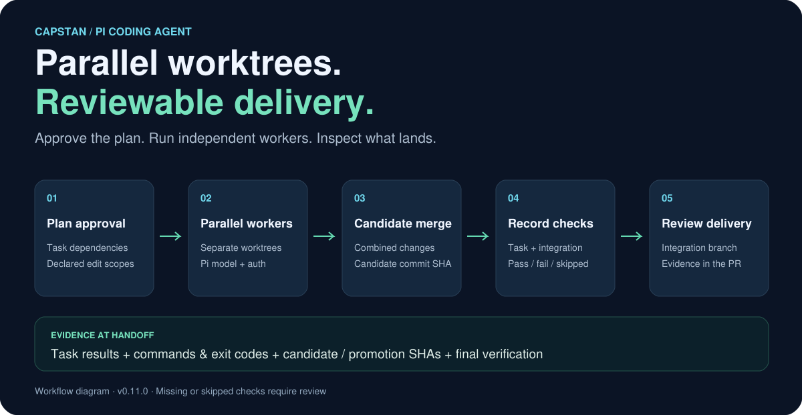
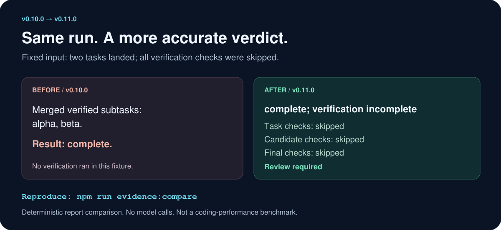

# Capstan · Multi-agent coding for Pi

**Parallel worktrees. Reviewable delivery.**

[](https://www.npmjs.com/package/pi-capstan)
[](https://github.com/Yongthyuan/pi-capstan/actions/workflows/ci.yml)
[](./LICENSE)
[](https://pi.dev/packages)

[中文](./README.zh-CN.md) · [Quick start](#quick-start) · [Before / after](#what-changed-in-v0110) · [Evidence](./docs/evidence/v0.11.0/README.md) · [Configuration](./docs/CONFIGURATION.md)

Capstan is a [Pi coding agent](https://github.com/earendil-works/pi) extension for **multi-agent coding orchestration**. Review a plan, run parallel subagents in separate Git worktrees, and inspect what landed with its test results and commit history. Your current Pi model and authentication carry through to the workers.



## Quick start

Requires **Node.js ≥22.19**, **Pi ≥0.84.1**, and a Git repository.

```bash
pi install npm:pi-capstan
```

Restart Pi. Select an authenticated model with `/login` and `/model`, then run:

```text
/capstan "add CSV export, implement the download button, and document the new endpoint"
```

Review the task plan before approving worker execution. Planning may already use provider tokens. Watch progress with `/capstan board`; inspect the finished integration branch and report before creating a PR with `/capstan pr`.

Capstan uses Pi's existing provider credentials. Explicit model overrides must resolve to an authenticated model; configuration errors stop the run. [Model and budget settings →](./docs/CONFIGURATION.md)

## Built for parallel changes you can review

| Capability | What it gives you | Implementation / checks |
|---|---|---|
| Human-approved plans | Inspect task dependencies and file ownership before workers start | [Plan validation](./src/plan-validation.ts) · [Lifecycle tests](./test/worker-orchestrator.test.ts) |
| Isolated Git worktrees | Separate workspaces for concurrent workers, with declared edit scopes | [Workspace](./src/workspace.ts) · [Scope and security tests](./test/resilience-security.test.ts) |
| Candidate merge and promotion | Inspect combined changes on a candidate before advancing the integration branch | [Orchestrator](./src/orchestrator.ts) · [Recovery tests](./test/recovery-hardening.test.ts) |
| Verification evidence in PRs | Task checks, candidate SHAs, final checks, and explicit review requirements | [Example PR](./docs/evidence/v0.11.0/after-pr.md) · [Reporter tests](./test/reporter.test.ts) |
| Usage budgets and recovery | Track token/cost estimates, limit further work, and recover interrupted runs | [Configuration](./docs/CONFIGURATION.md) · [State](./src/state.ts) |
| Pi-native model selection | Reuse the selected provider and Pi authentication across planning and workers | [Model policy](./src/model-policy.ts) · [Model tests](./test/model-policy.test.ts) |

Best suited to changes with separable files or modules and meaningful project checks. Worktrees separate Git state; they are not an OS security sandbox. Budget enforcement depends on reported usage, and dollar figures are estimates.

## What changed in v0.11.0

**Same input, different delivery verdict.** We replayed one fixed run through the published v0.10.0 reporter and the v0.11.0 reporter: two tasks landed, but task, candidate, and final verification were all skipped.



| Evidence | v0.10.0 | v0.11.0 |
|---|---|---|
| All checks skipped | PR says “Merged verified subtasks” and “Result: complete” | PR says “complete; verification incomplete” and requests review |
| Final check absent | Complete result label follows run state | Missing evidence prevents a verified-success verdict |
| Review detail | Merged task names | Task checks, candidate/promotion SHAs, and final integration checks |
| Local test suite | 61 passing tests at the published tag | 80 passing tests for this release |

This is a deterministic reporting comparison, **not a model-performance benchmark**. Test counts describe different suites, not a coverage percentage. [Inputs, raw outputs, controls, and reproduction →](./docs/evidence/v0.11.0/README.md)

A recorded DeepSeek smoke run also took two small modules from failing tests through two real Pi workers to a passing integration branch: **17 worker turns, 21,532 tokens, estimated $0.0208**. It used the recorded development source snapshot; it is one synthetic run. A separate earlier planner smoke completed **4/10 cases**, and a later OAuth plan was rejected for unsafe command syntax. Complex planning remains a limitation. [Full validation record →](./docs/validation-2026-09-09.md)

## Commands

```text
/capstan "task"                       propose a plan and start after approval
/capstan "task" --plan-only           inspect a plan without starting workers
/capstan board                       view worker progress
/capstan pause | resume | abort       control a run
/capstan replan                       propose additional work
/capstan merge | clean | replay       manage finished runs
/capstan pr [runId]                   push the integration branch and open a PR
/capstan config | validate | status   configure and inspect
/capstan cases                       browse and rate previous runs
```

The `capstan_delegate` tool exposes the same plan-approval flow to Pi. Options include `--force`, `--max 4`, and `--best-of 2`; see the [command guide](./docs/README.md).

## Documentation and development

- [Delivery evidence](./docs/EVIDENCE.md) — how to read the report and Proof-Carrying PR (recorded checks, not formal proof)
- [Configuration](./docs/CONFIGURATION.md) — models, concurrency, budgets, verification, and merge policy
- [Design](./docs/DESIGN_PHILOSOPHY.md) · [Extensions](./docs/EXTENSION_POINTS.md) · [Plugins](./docs/PLUGINS.md)
- [Examples](./docs/examples/README.md) · [Benchmark protocol](./scripts/bench/README.md) · [Changelog](./CHANGELOG.md)

```bash
git clone https://github.com/Yongthyuan/pi-capstan.git
cd pi-capstan
npm ci
npm run check
npm test
npm run test:native       # offline: Pi registration + guarded worker startup
npm run evidence:compare  # offline: regenerate the before/after fixture
pi -e ./index.ts          # load the checkout in Pi
```

Provider-backed validation is opt-in and incurs provider usage:

```bash
PI_CAPSTAN_TEST_MODEL=deepseek/deepseek-v4-flash npm run test:native:e2e
```

CI checks Linux and Windows on pushes, with a scheduled soak workflow. The UI currently mixes English and Chinese. Contributions are welcome: include the task, version, model/provider, relevant checks, and a redacted reproduction in [an issue](https://github.com/Yongthyuan/pi-capstan/issues).

Capstan is named after the winch used to coordinate many hands on one load. Formerly `pi-agent-swarm`. [MIT licensed](./LICENSE).
